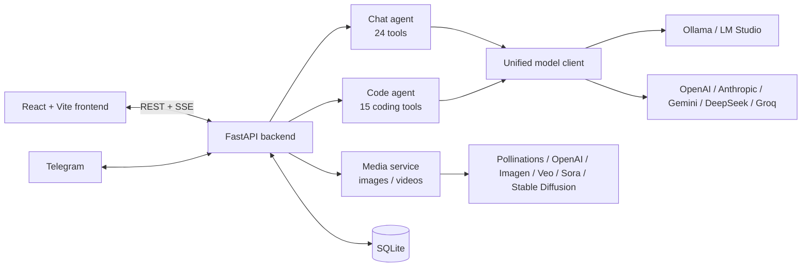

<p align="center">
  <a href="README.md">繁體中文</a> ·
  <a href="README.zh-CN.md">简体中文</a> ·
  <b>English</b> ·
  <a href="README.ja.md">日本語</a>
</p>

# 💧 Aether AI Studio 4.1

> An autonomous AI agent studio for local and cloud models, with a Liquid Glass interface.
> Chat, let the agent write code, and generate images and videos, using local models through Ollama / LM Studio or cloud models from OpenAI, Anthropic, Gemini, DeepSeek, Groq and others.

---

## ✨ Features

### 💻 Autonomous coding agent (Code mode)
Works like Claude Code or Cursor's agent: it searches and reads the code, makes precise edits, then runs the tests itself until the task is done.
- **15 dedicated tools**: `list_dir`, `glob`, `grep`, `read_file`, `edit_file`, `multi_edit`, `write_file`, `delete_path`, `move_path`, `run_command`, `git`, `check_syntax`, `web_fetch`, `web_search`, `todo_write`. Each can be switched on or off in Settings → Toolbox → Code agent tools.
- **Memory across turns**: tool calls and results are kept, so "continue" or a follow-up request picks up where it left off; the context is compacted automatically when it fills up.
- **Three execution modes**: Auto (fully autonomous), Accept Edit (every file change or command shows a diff or the command first; you approve, or reject with a note) and Turbo (minimal narration).
- **Guard rails**: files must be read before they are edited, indentation differences are tolerated, edits that delete existing functions or change existing test assertions are rejected, and repeated actions and stuck loops are detected.
- `AGENTS.md` / `CLAUDE.md` in the project root is loaded automatically as project instructions.

### 🎨 Image and video generation (Media Studio)
- **Images**: Pollinations (free, no API key), OpenAI `gpt-image-1`, Google Imagen, local Stable Diffusion (AUTOMATIC1111 / Forge).
- **Videos**: Google Veo and OpenAI Sora, rendered in the background with progress polling.
- A gallery to preview, download and delete results. In chat, just ask "draw me…": the assistant calls `generate_image` / `generate_video` and shows the result in the message.

### 🧠 Chat agent with 24 tools
Web search, web reading, a Python sandbox, terminal, files, long-term memory, charts, Mermaid diagrams, document extraction, OCR, Git, SQLite, data conversion, hashing, regex, archives, network diagnostics, image and video generation and more. Native function calling, plus a text-format fallback for small local models.

### ⚡ Optimised for local models
- **Hardware check**: when you change max tokens or the context window, it reads your GPU memory and the model's architecture, estimates memory use, warns if layers would spill to the CPU, and suggests values that fit.
- Faster generation: the Ollama model stays loaded, a compact system prompt, and throttled streaming rendering.

### 👁️ Multimodal vision
Paste (Ctrl+V) or drag in images. Vision models see them directly; for text-only models, a background vision model or Windows OCR extracts the content first.

### 🌐 And more
- Four UI languages: 繁體中文, 简体中文, English, 日本語 (the AI replies in the UI language).
- AI prompt enhancer: rewrites your prompt with the current model, keeping its language; falls back to templates in four languages.
- Native desktop app, Tauri launcher with auto-update, Telegram bot bridge.
- PIN protection for remote access, enforced by the server.

---

## 🚀 Quick start

```bash
git clone https://github.com/hankyleisplay/AetherAI-Studio.git
cd AetherAI-Studio
```

**Windows**: run `launch.bat` (or `.\launch.ps1`) and choose the desktop app, the browser version or an update.
You can also download the `AetherLauncher.exe` launcher from [Releases](https://github.com/hankyleisplay/AetherAI-Studio/releases).

**Linux / macOS**:
```bash
chmod +x run.sh
./run.sh
```
or `python3 start.py`.

Then open `http://localhost:8000`.

### Updating
In an existing clone, run `update.bat` (Windows) or `./update.sh` (Linux / macOS). Your workspace and conversations are kept.

---

## ⚙️ Configuration

| What | Where |
|---|---|
| Model endpoint, API key, temperature, max tokens, context window (with hardware check) | Settings (top right) → Model |
| Chat tools and Code agent tools on/off | Settings → Toolbox |
| Image / video services, API keys, Stable Diffusion URL | Header → Media → Settings |
| Telegram bot bridge | Settings → Telegram |
| Remote access PIN | Settings → Security |

**Local models**: pick Ollama or LM Studio; no API key needed.
**Telegram**: get a token from [@BotFather](https://t.me/BotFather), paste it in Settings and enable the bridge.

---

## 🏗️ Architecture



---

## 🧪 Tests

```bash
python test_backend.py
```

## 📄 License

[MIT License](LICENSE). Built by hankyledevteam (Hanson Lee). Stars and contributions are welcome!
