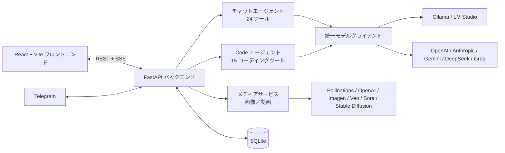

<p align="center">
  <a href="README.md">繁體中文</a> ·
  <a href="README.zh-CN.md">简体中文</a> ·
  <a href="README.en.md">English</a> ·
  <b>日本語</b>
</p>

# 💧 Aether AI Studio 4.1

> ローカルとクラウドの両方に対応した自律 AI エージェントスタジオ。Liquid Glass デザインのインターフェース。
> チャット、自律コーディング、画像・動画生成に対応し、Ollama／LM Studio のローカルモデルと OpenAI、Anthropic、Gemini、DeepSeek、Groq などのクラウドモデルを使えます。

---

## ✨ 主な機能

### 💻 自律コーディングエージェント（Code モード）
Claude Code や Cursor のエージェントのように、コードを検索・読解してから正確に編集し、最後に自分でテストを実行して、タスクが完了するまで作業します。
- **15 個の専用ツール**：`list_dir`、`glob`、`grep`、`read_file`、`edit_file`、`multi_edit`、`write_file`、`delete_path`、`move_path`、`run_command`、`git`、`check_syntax`、`web_fetch`、`web_search`、`todo_write`。「設定 → ツールボックス → Code エージェント用ツール」で個別にオン／オフできます。
- **ターンをまたぐ記憶**：ツール呼び出しと結果を保持するので、「続けて」や追加の依頼でそのまま作業を再開できます。コンテキストが埋まると自動で要約します。
- **3 つの実行モード**：Auto（完全自律）、Accept Edit（ファイル変更やコマンド実行の前に差分／コマンドを表示し、承認または理由付きで拒否）、Turbo（説明を省いて高速）。
- **安全装置**：読んでいないファイルは編集不可、インデントの違いに対応、既存の関数の削除や既存テストのアサーション変更を拒否、同じ操作の繰り返しや行き詰まりを検出。
- プロジェクト直下の `AGENTS.md`／`CLAUDE.md` をプロジェクトの指示として自動で読み込みます。

### 🎨 画像・動画生成（メディアスタジオ）
- **画像**：Pollinations（無料・API キー不要）、OpenAI `gpt-image-1`、Google Imagen、ローカル Stable Diffusion（AUTOMATIC1111／Forge）。
- **動画**：Google Veo、OpenAI Sora。バックグラウンドで生成し、進捗を自動で確認します。
- ギャラリーでプレビュー・ダウンロード・削除が可能。チャットで「〜を描いて」と頼むと、アシスタントが `generate_image`／`generate_video` を呼び出し、結果をメッセージ内に表示します。

### 🧠 24 個のツールを持つチャットエージェント
Web 検索、Web ページ閲覧、Python サンドボックス、ターミナル、ファイル、長期記憶、グラフ、Mermaid、ドキュメント抽出、OCR、Git、SQLite、データ変換、ハッシュ、正規表現、圧縮、ネットワーク診断、画像・動画生成など。ネイティブの Function Calling に加え、小規模なローカルモデル向けにテキスト形式のツール呼び出しにも対応します。

### ⚡ ローカルモデル向けの最適化
- **ハードウェア評価**：最大出力長やコンテキストを変更すると、GPU メモリとモデル構造を読み取って必要メモリを推定し、CPU へのオフロードが起きるかを判定して推奨値を提示します。
- Ollama モデルの常駐、簡潔なシステムプロンプト、ストリーミング描画の間引きなどで生成を高速化。

### 👁️ マルチモーダル
Ctrl+V で貼り付け、またはドラッグで画像を追加できます。ビジョンモデルは画像を直接理解し、テキスト専用モデルの場合はバックグラウンドのビジョンモデルか Windows OCR が先に内容を抽出します。

### 🌐 その他
- 4 つの UI 言語：繁體中文、简体中文、English、日本語（AI の返答言語も UI に合わせます）。
- AI プロンプト最適化：現在のモデルでプロンプトを書き直し、元の言語を保ちます。モデルがない場合は 4 言語のテンプレートを使います。
- ネイティブのデスクトップ版、自動更新付き Tauri ランチャー、Telegram ボット連携。
- リモートアクセス用 PIN 保護（サーバー側で検証）。

---

## 🚀 クイックスタート

```bash
git clone https://github.com/hankyleisplay/AetherAI-Studio.git
cd AetherAI-Studio
```

**Windows**：`launch.bat`（または `.\launch.ps1`）を実行し、デスクトップ版・ブラウザ版・更新から選びます。
[Releases](https://github.com/hankyleisplay/AetherAI-Studio/releases) から `AetherLauncher.exe` ランチャーをダウンロードすることもできます。

**Linux／macOS**：
```bash
chmod +x run.sh
./run.sh
```
または `python3 start.py`。

起動後、`http://localhost:8000` を開きます。

### 更新
既に Clone 済みの場合は `update.bat`（Windows）または `./update.sh`（Linux／macOS）を実行します。ワークスペースと会話データは保持されます。

---

## ⚙️ 設定

| 項目 | 場所 |
|---|---|
| モデルのエンドポイント、API キー、温度、最大出力長、コンテキスト（ハードウェア評価付き） | 右上の「設定 → モデル」 |
| チャット用ツールと Code エージェント用ツールのオン／オフ | 「設定 → ツールボックス」 |
| 画像／動画サービス、API キー、Stable Diffusion の URL | ヘッダーの「メディア → 設定」 |
| Telegram ボット連携 | 「設定 → Telegram」 |
| リモートアクセス PIN | 「設定 → セキュリティ」 |

**ローカルモデル**：Ollama か LM Studio を選ぶだけで、API キーは不要です。
**Telegram**：[@BotFather](https://t.me/BotFather) でトークンを取得し、設定に貼り付けて有効にします。

---

## 🏗️ アーキテクチャ



---

## 🧪 テスト

```bash
python test_backend.py
```

## 📄 ライセンス

[MIT License](LICENSE)。hankyledevteam（Hanson Lee）が開発しています。Star やコントリビューションを歓迎します！
