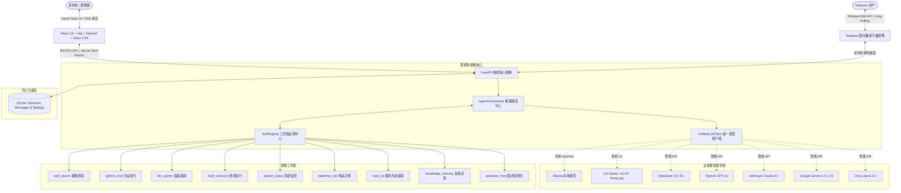

# 💧 Aether AI Studio 3.0 (AetherAgent)

> **極致美感 Liquid Glass（流光水感毛玻璃 / Apple VisionOS 前瞻設計風格）本地與雲端雙模自主 AI Agent 系統。**  
> 全新 3.0 版本升級：原生獨立桌面應用程式 (Desktop App)、Ctrl+V 貼上/拖曳圖片多模態視覺識別、雙軌視覺路由 (Dual-Track Vision Routing)、Windows 本機 OCR 引擎、14 大智慧工具鏈與跨平台免安裝一鍵啟動。

---

## ⚡ 零安裝快速啟動 (One-Step Quick Start)

無需繁瑣手動安裝環境，直接 Clone 儲存庫並執行啟動腳本，系統將全自動配置依賴並引導啟動：

```bash
git clone https://github.com/hankyleisplay/AetherAI-Studio.git
cd AetherAI-Studio
```

啟動互動式導航（會主動詢問您要啟動「獨立桌面視窗版」、「一般網頁瀏覽器版」或「檢查並更新至最新版本」）：

```cmd
.\launch.bat
```

或在 Windows PowerShell 中執行：

```powershell
.\launch.ps1
```

> 💡 **啟動腳本將引導您選擇**：
> - `[1] 獨立桌面視窗版 (Desktop App)`：啟動原生獨立應用程式視窗，享受無邊框 Liquid Glass 沉浸體驗 (`.\run.ps1 -Desktop`)。
> - `[2] 一般網頁瀏覽器版 (Web Browser)`：在預設瀏覽器分頁開啟 Web 介面 (`.\run.ps1`)。
> - `[3] 檢查並更新至最新版本 (Update to Latest Version)`：自動拉取遠端最新版本，並保護本機對話與工作區資料不衝突。
>
> 亦可建立桌面專屬圖示捷徑：雙擊執行 `create_desktop_shortcut.bat`。

---

## 🔄 系統一鍵更新 (Smart Auto-Update)

如果您已經 Clone 過專案，當有新版本發布時，請**不要再次 `git clone`**（Git 會因目錄非空而報錯），您可以使用以下任一方式極速更新：

### 方法一：專屬一鍵更新腳本（最簡單推薦）
在專案根目錄下直接雙擊或執行：
```cmd
.\update.bat
```
或在 PowerShell 執行：
```powershell
.\update.ps1
```
*(腳本會自動保護您的工作區與資料庫、拉取 GitHub 最新程式碼、自動配置新依賴，並詢問是否立即啟動！)*

### 方法二：在啟動選單中直接選擇更新
執行 `.\launch.bat` 或 `.\launch.ps1`，輸入 `[3]` 即可一鍵檢查並升級至最新版。

### 方法三：全自動智慧指令（已下載則自動更新，未下載則自動 Clone）
* **Windows PowerShell**:
  ```powershell
  if (Test-Path AetherAI-Studio) { cd AetherAI-Studio; .\update.ps1 } else { git clone https://github.com/hankyleisplay/AetherAI-Studio.git; cd AetherAI-Studio; .\launch.ps1 }
  ```
* **Windows CMD**:
  ```cmd
  if exist AetherAI-Studio (cd AetherAI-Studio && update.bat) else (git clone https://github.com/hankyleisplay/AetherAI-Studio.git && cd AetherAI-Studio && launch.bat)
  ```
* **Linux / macOS**:
  ```bash
  if [ -d "AetherAI-Studio" ]; then cd AetherAI-Studio && ./update.sh; else git clone https://github.com/hankyleisplay/AetherAI-Studio.git && cd AetherAI-Studio && ./run.sh; fi
  ```

---

## ✨ 3.0 核心特色亮點

### 1. 👁️ 多模態視覺識別與雙軌路由 (Multimodal Vision & Dual-Track Routing)
* **便捷輸入支援**：直接在輸入框 **Ctrl+V 貼上截圖** 或 **拖曳圖像檔案**，即刻呈現精美毛玻璃縮圖微縮預覽。
* **雙軌智能路由架構**：
  - **軌道 A（多模態視覺模型，如 `qwen2.5-vl`、`llava`、`gemini-1.5/2.5`）**：圖片自動轉換乾淨 Base64，原生封裝至模型 `images` 欄位進行高解析度視覺推理。
  - **軌道 B（純文字模型，如 `llama3`、`deepseek-r1`、`mistral`）**：背景自動調度視覺模型或 Windows 原生 OCR 引擎提取文字與空間結構，將深度視覺摘要自動注入 Prompt，讓純文字模型也能精準「看懂」圖片與圖表！
* **`ocr_extractor` 專屬核心工具**：支援工作區圖片的光學字符識別、區塊劃分與文字萃取。

### 2. 🖥️ 原生獨立桌面版 (Native Desktop App)
* 透過原生視窗引擎獨立運行，擺脫瀏覽器分頁干擾。
* 隨附 `create_desktop_shortcut.bat` 一鍵在 Windows 桌面生成 Aether AI Studio 3.0 專屬圖示捷徑。

### 3. 🌊 Liquid Glass 3.0 水感極致美學 (Liquid Glass Aesthetics)
* **動態流體光球反應（Adaptive Ambient Fluid）**：背景光暈球依據 Agent 當前運作狀態即時變幻色彩與脈動律動：
  - 🌌 **閒置待命（Idle）**：深邃星空藍與青藍微光流轉。
  - 🔮 **深度思考（Thinking）**：紫羅蘭與洋紅波紋脈衝，展開即時思維鏈（Reasoning Chain）。
  - 🌿 **執行工具（Calling Tool）**：翡翠綠與琉璃金流光迴旋，清晰呈現調用參數與毫秒級執行結果。
  - ⚡ **串流生成（Streaming）**：高科技電光青與藍調流體漣漪。
* **高階光學毛玻璃（Optical Glassmorphism）**：`backdrop-blur-2xl` 高斯模糊、折射鏡面反光邊框（Specular Highlights）與半透明浮雕陰影。

### 4. ✈️ Telegram 雙向智能體橋接 (Telegram Bot Bridge)
* **背景非同步長輪詢守護行程**：基於 Python `asyncio` + `httpx`，無需公網 Webhook，內網或本機環境即可直連 Telegram。
* **無縫銜接 Agent 核心**：在 Telegram 中傳送文字，Agent 會自動發送 `typing` 打字狀態，自主思考並調用 14 大工具執行任務後回傳。

### 5. 📐 科學級 LaTeX 數學公式排版 (LaTeX Math Typesetting)
* **輕量無依賴公式引擎**：融合數學符號解析系統，自動識別並美化公式。
* 行內公式（`$e^{i\pi} + 1 = 0$`）與獨立區塊公式（`$$\int_{0}^{\infty} e^{-x^2} dx = \frac{\sqrt{\pi}}{2}$$`）。

### 6. 🧠 雙模推理引擎（Dual-Mode Reasoning Engine）
* **原生 Function Calling**：完美對接 GPT-4o、Claude 3.5 Sonnet、Gemini 2.5 Flash、DeepSeek-V3 等雲端高階模型的標準 JSON Tool Calling 協議。
* **智慧 ReAct 文字推理後備機制（Smart ReAct Fallback）**：針對 7B/8B 本地量化模型（如 Llama 3、Mistral、Qwen 等）不擅長輸出 JSON Schema 的情況，內建文字 ReAct 解析器，讓小參數本地模型也能順暢調用工具！

### 7. 🔌 開箱即用的 14 大強大工具箱（Pluggable Tools）
* 🔍 **即時網路檢索 (`web_search`)**：免 API Key，直接透過 DuckDuckGo 即時搜尋全網資訊並擷取摘要。
* 👁️ **光學字符識別 (`ocr_extractor`)**：快速提取工作區圖片文字與排版結構。
* 🌐 **特定網頁提取器 (`read_url`)**：給定任意 URL，自動解析去除雜訊與廣告，提煉乾淨可讀正文內容。
* 🧠 **跨會話長效記憶庫 (`knowledge_memory`)**：持久化儲存特定背景、偏好與知識要點，打破會話隔閡。
* 📊 **視覺化圖表生成器 (`generate_chart`)**：生成長條圖、折線圖與比例圖數據，UI 即時繪製玻璃感動態圖表。
* 🐍 **Python 沙盒計算機 (`python_eval`)**：即時編譯執行 Python 腳本、數學計算與演算法驗證。
* 📂 **工作區檔案系統 (`file_system`)**：受沙盒防護的安全本地檔案讀取、寫入、檔案清單檢視與管理。
* 🖥️ **命令列終端執行器 (`bash_executor`)**：受控執行的 Shell 指令環境（具備危險指令攔截與逾時保護）。
* 📊 **主機系統狀態診斷 (`system_status`)**：即時讀取 CPU 核心負載、記憶體剩餘、磁碟可用容量與作業系統資訊。
* ⏰ **日期時間與時區運算 (`datetime_calc`)**：精確的時間日期運算與多時區解析。

### 8. 📝 企業級全功能 Markdown 系統 (Powerful Markdown Engine)
* 📊 **Mermaid 視覺化向量圖表**：支援流程圖（`flowchart TD/LR`）與時序序列圖（`sequenceDiagram`），具備圖表/原始碼雙模式切換、縮放與 SVG 向量圖匯出。
* 💻 **高級代碼語法高亮**：支援 Python, TS, JS, Bash, SQL, Rust, Go 等多語言詞法著色，獨立行號槽、超過 20 行智慧折疊與一鍵下載代碼檔案。
* 🚨 **GitHub 風格五大警示塊**：原生支援 `> [!NOTE]`、`> [!TIP]`、`> [!IMPORTANT]`、`> [!WARNING]` 與 `> [!CAUTION]` 毛玻璃光澤卡片。

### 9. 🌐 全方位多國語言國際化 (Multi-Language i18n)
* 支援 4 大主要語系：🇹🇼 **繁體中文 (`zh-TW`)**、🇨🇳 **简体中文 (`zh-CN`)**、🇺🇸 **English (`en`)**、🇯🇵 **日本語 (`ja`)**。

### 10. 🎙️ 雙向語音互動
* 🎤 **語音聽寫輸入（Voice Dictation）**：採用 Web Speech API 即時語音轉文字。
* 🔊 **語音朗讀合成（Text-to-Speech）**：修復單詞重複問題，平滑自然朗讀。

---

## 🏗️ 系統架構



---

## 🚀 快速開始

### 方式 A：Windows 使用者（PowerShell 一鍵啟動）

在專案目錄下開啟 PowerShell 執行：

```powershell
# 啟動伺服器並自動開啟瀏覽器
.\run.ps1
```

首次安裝可執行：
```powershell
.\install.ps1
```

選項參數：
```powershell
.\run.ps1 -Port 8888      # 自訂連接埠
.\run.ps1 -Dev            # 同時啟動 FastAPI 與 Vite 前端熱重載
.\run.ps1 -Check          # 執行環境與 9 大工具自我診斷
```

---

### 方式 B：Linux / macOS 使用者

執行一鍵啟動腳本：

```bash
chmod +x run.sh
./run.sh
```

或使用全能啟動器：
```bash
python3 start.py
```

自檢診斷：
```bash
python3 start.py --check
```

---

## ⚙️ 模型與 Telegram 設定

啟動後於瀏覽器造訪 `http://localhost:8000`，點擊右上角 **⚙️ 設定圖示**：

### 1. 模型端點設定
* **本地模型**：選擇「Ollama」或「LM Studio」，免填 API Key，點擊「測試連線並拉取模型」可自動探測已下載的模型清單。
* **雲端模型**：支援切換至 OpenAI、Anthropic Claude、Google Gemini、DeepSeek 或 Groq，貼上 API Key 即刻生效。

### 2. Telegram Bot 橋接設定
1. 向 [@BotFather](https://t.me/BotFather) 發送 `/newbot` 取得 Bot Token。
2. 在設定中心貼上 Token。
3. （可選）向 [@userinfobot](https://t.me/userinfobot) 取得您的 Chat ID 並填入以啟用安全存取白名單。
4. 打開「啟用 Telegram 智能代理橋接」開關並點擊儲存，服務即在背景自動運作！

---

## 🧪 自我診斷與測試

本專案提供端到端自動化整合測試套件：

```bash
python3 test_backend.py
```

測試涵蓋：
* 系統健康狀態與 SQLite 資料庫連線
* 模型設定保存與動態探測
* 9 大內建工具執行能力
* 對話 Session 建立與 Markdown 匯出
* Telegram 橋接器狀態與配置端點
* Liquid Glass 前端 SPA 靜態託管

---

## 📄 開源授權

本專案採用 [MIT License](LICENSE) 授權。由 Hankyle 打造，歡迎 Star 與共同貢獻！
