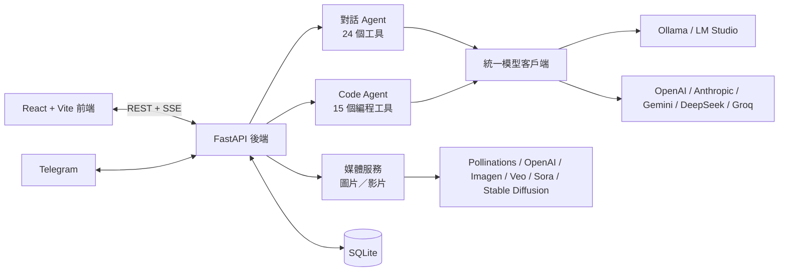

<p align="center">
  <b>繁體中文</b> ·
  <a href="README.zh-CN.md">简体中文</a> ·
  <a href="README.en.md">English</a> ·
  <a href="README.ja.md">日本語</a>
</p>

# 💧 Aether AI Studio 4.1

> 本機與雲端雙模的自主 AI Agent 工作室，Liquid Glass 毛玻璃介面。
> 對話、自主寫程式、生成圖片與影片，支援 Ollama／LM Studio 本機模型與 OpenAI、Anthropic、Gemini、DeepSeek、Groq 等雲端模型。

---

## ✨ 主要功能

### 💻 自主編程 Agent（Code 模式）
像 Claude Code、Cursor Agent 一樣：先搜尋與閱讀程式碼，再精準修改，最後自己執行測試驗證，直到任務完成。
- **15 個專用工具**：`list_dir`、`glob`、`grep`、`read_file`、`edit_file`、`multi_edit`、`write_file`、`delete_path`、`move_path`、`run_command`、`git`、`check_syntax`、`web_fetch`、`web_search`、`todo_write`，可在「設定 → 工具箱 → Code Agent 工具」個別開關。
- **跨回合記憶**：完整保存工具呼叫與結果，說「繼續」或追加需求即可接著做；上下文快滿時自動精簡。
- **三種執行模式**：Auto（全自動）、Accept Edit（每次改檔或執行指令前顯示 diff／指令，由你允許或拒絕並可附說明）、Turbo（精簡快速）。
- **防呆與防作弊**：未讀不可改、容忍縮排差異、拒絕刪除既有函式或修改既有測試斷言、偵測重複操作與卡住迴圈。
- 專案根目錄的 `AGENTS.md`／`CLAUDE.md` 會自動讀入作為專案規範。

### 🎨 圖片與影片生成（媒體工作室）
- **圖片**：Pollinations（免費、免 API Key）、OpenAI `gpt-image-1`、Google Imagen、本機 Stable Diffusion（AUTOMATIC1111／Forge）。
- **影片**：Google Veo、OpenAI Sora，於背景生成並自動輪詢進度。
- 作品庫可預覽、下載、刪除；對話中直接說「幫我畫…」，助理會呼叫 `generate_image`／`generate_video` 並在訊息中顯示成品。

### 🧠 對話 Agent 與 24 個工具
網路搜尋、網頁閱讀、Python 沙盒、終端機、檔案、長期記憶、圖表、Mermaid、文件擷取、OCR、Git、SQLite、資料轉換、雜湊、正規表達式、壓縮、網路診斷、圖片與影片生成等。支援原生 Function Calling，並為本機小模型提供文字格式的工具呼叫後援。

### ⚡ 本機模型最佳化
- **硬體效能評估**：調整最大輸出長度與上下文視窗時，自動讀取 GPU 顯存與模型架構，預估記憶體並判斷是否會卸載到 CPU，提供建議值。
- Ollama 模型常駐、精簡系統提示詞、串流渲染節流等生成速度優化。

### 👁️ 多模態視覺
Ctrl+V 貼上或拖曳圖片；視覺模型直接看圖，純文字模型則先由背景視覺模型或 Windows OCR 擷取內容。

### 🌐 其他
- 四種介面語言：繁體中文、简体中文、English、日本語（AI 回覆語言跟隨介面）。
- AI 提示詞優化：以目前模型改寫提示詞，保持原本語言；無模型時改用四語範本。
- 原生桌面版、Tauri 啟動器（自動更新）、Telegram Bot 橋接。
- 外網存取 PIN 碼保護（由後端強制驗證）。

---

## 🚀 快速開始

```bash
git clone https://github.com/hankyleisplay/AetherAI-Studio.git
cd AetherAI-Studio
```

**Windows**：執行 `launch.bat`（或 `.\launch.ps1`），可選擇桌面版、瀏覽器版或更新。
也可以到 [Releases](https://github.com/hankyleisplay/AetherAI-Studio/releases) 下載 `AetherLauncher.exe` 啟動器。

**Linux／macOS**：
```bash
chmod +x run.sh
./run.sh
```
或 `python3 start.py`。

啟動後開啟 `http://localhost:8000`。

### 更新
已 Clone 過的專案請執行 `update.bat`（Windows）或 `./update.sh`（Linux／macOS），會保留工作區與對話資料。

---

## ⚙️ 設定

| 項目 | 位置 |
|---|---|
| 模型端點、API Key、溫度、最大輸出長度、上下文視窗（含硬體評估） | 右上角「設定 → 模型」 |
| 對話工具與 Code Agent 工具的開關 | 「設定 → 工具箱」 |
| 圖片／影片服務、API Key、Stable Diffusion 位址 | 頂端列「媒體 → 設定」 |
| Telegram Bot 橋接 | 「設定 → Telegram」 |
| 外網存取 PIN 碼 | 「設定 → 外網安全」 |

**本機模型**：選 Ollama 或 LM Studio 即可，免 API Key。
**Telegram**：向 [@BotFather](https://t.me/BotFather) 取得 Token，貼到設定中並啟用。

---

## 🏗️ 架構



---

## 🧪 測試

```bash
python test_backend.py
```

## 📄 授權

[MIT License](LICENSE)。由 hankyledevteam（Hanson Lee）開發，歡迎 Star 與貢獻！
