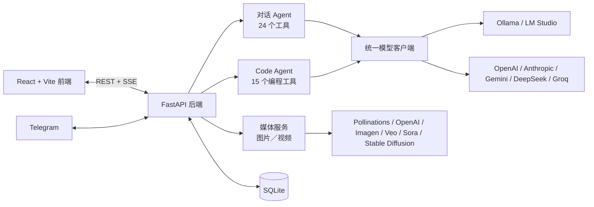

<p align="center">
  <a href="README.md">繁體中文</a> ·
  <b>简体中文</b> ·
  <a href="README.en.md">English</a> ·
  <a href="README.ja.md">日本語</a>
</p>

# 💧 Aether AI Studio 4.1

> 本地与云端双模的自主 AI Agent 工作室，Liquid Glass 毛玻璃界面。
> 对话、自主写代码、生成图片与视频，支持 Ollama／LM Studio 本地模型与 OpenAI、Anthropic、Gemini、DeepSeek、Groq 等云端模型。

---

## ✨ 主要功能

### 💻 自主编程 Agent（Code 模式）
像 Claude Code、Cursor Agent 一样：先搜索与阅读代码，再精准修改，最后自己运行测试验证，直到任务完成。
- **15 个专用工具**：`list_dir`、`glob`、`grep`、`read_file`、`edit_file`、`multi_edit`、`write_file`、`delete_path`、`move_path`、`run_command`、`git`、`check_syntax`、`web_fetch`、`web_search`、`todo_write`，可在「设置 → 工具箱 → Code Agent 工具」单独开关。
- **跨回合记忆**：完整保存工具调用与结果，说「继续」或追加需求即可接着做；上下文快满时自动精简。
- **三种执行模式**：Auto（全自动）、Accept Edit（每次改文件或执行命令前显示 diff／命令，由你允许或拒绝并可附说明）、Turbo（精简快速）。
- **防呆与防作弊**：未读不可改、容忍缩进差异、拒绝删除已有函数或修改已有测试断言、检测重复操作与卡死循环。
- 项目根目录的 `AGENTS.md`／`CLAUDE.md` 会自动读入作为项目规范。

### 🎨 图片与视频生成（媒体工作室）
- **图片**：Pollinations（免费、免 API Key）、OpenAI `gpt-image-1`、Google Imagen、本地 Stable Diffusion（AUTOMATIC1111／Forge）。
- **视频**：Google Veo、OpenAI Sora，在后台生成并自动轮询进度。
- 作品库可预览、下载、删除；在对话中直接说「帮我画…」，助手会调用 `generate_image`／`generate_video` 并在消息中显示成品。

### 🧠 对话 Agent 与 24 个工具
网络搜索、网页阅读、Python 沙盒、终端、文件、长期记忆、图表、Mermaid、文档提取、OCR、Git、SQLite、数据转换、哈希、正则表达式、压缩、网络诊断、图片与视频生成等。支持原生 Function Calling，并为本地小模型提供文本格式的工具调用后备。

### ⚡ 本地模型优化
- **硬件性能评估**：调整最大输出长度与上下文窗口时，自动读取 GPU 显存与模型架构，预估内存并判断是否会卸载到 CPU，给出建议值。
- Ollama 模型常驻、精简系统提示词、流式渲染节流等生成速度优化。

### 👁️ 多模态视觉
Ctrl+V 粘贴或拖拽图片；视觉模型直接看图，纯文本模型则先由后台视觉模型或 Windows OCR 提取内容。

### 🌐 其他
- 四种界面语言：繁體中文、简体中文、English、日本語（AI 回复语言跟随界面）。
- AI 提示词优化：用当前模型改写提示词并保持原语言；无模型时改用四语模板。
- 原生桌面版、Tauri 启动器（自动更新）、Telegram Bot 桥接。
- 外网访问 PIN 码保护（由后端强制验证）。

---

## 🚀 快速开始

```bash
git clone https://github.com/hankyleisplay/AetherAI-Studio.git
cd AetherAI-Studio
```

**Windows**：运行 `launch.bat`（或 `.\launch.ps1`），可选择桌面版、浏览器版或更新。
也可以到 [Releases](https://github.com/hankyleisplay/AetherAI-Studio/releases) 下载 `AetherLauncher.exe` 启动器。

**Linux／macOS**：
```bash
chmod +x run.sh
./run.sh
```
或 `python3 start.py`。

启动后打开 `http://localhost:8000`。

### 更新
已 Clone 的项目请运行 `update.bat`（Windows）或 `./update.sh`（Linux／macOS），会保留工作区与对话数据。

---

## ⚙️ 设置

| 项目 | 位置 |
|---|---|
| 模型端点、API Key、温度、最大输出长度、上下文窗口（含硬件评估） | 右上角「设置 → 模型」 |
| 对话工具与 Code Agent 工具的开关 | 「设置 → 工具箱」 |
| 图片／视频服务、API Key、Stable Diffusion 地址 | 顶部栏「媒体 → 设置」 |
| Telegram Bot 桥接 | 「设置 → Telegram」 |
| 外网访问 PIN 码 | 「设置 → 外网安全」 |

**本地模型**：选 Ollama 或 LM Studio 即可，免 API Key。
**Telegram**：向 [@BotFather](https://t.me/BotFather) 获取 Token，粘贴到设置中并启用。

---

## 🏗️ 架构



---

## 🧪 测试

```bash
python test_backend.py
```

## 📄 许可

[MIT License](LICENSE)。由 hankyledevteam（Hanson Lee）开发，欢迎 Star 与贡献！
